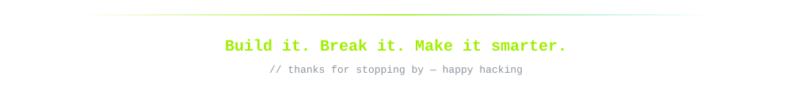

<div align="center">



<br />

<a href="https://www.linkedin.com/in/brian-lm/"></a>
<a href="https://brianmedinadev.netlify.app/"></a>


</div>

<br />

## `$ cat about.py`

```python
class BrianLopez:
    roles     = ["AI Engineer", "Pentester", "Software Engineer"]
    location  = "Durango, Mexico 🇲🇽"
    building  = "AI-powered products and agents"
    studying  = "OSCP — Offensive Security Certified Professional"
    certs     = ["eJPT — eLearnSecurity Junior Penetration Tester"]
    htb       = {"user": "BrianM", "rank": "Hacker", "next": "Pro Hacker"}
    writes_on = "linkedin.com/in/brian-lm"

    def motto(self):
        return "Build it. Break it. Make it smarter."
```

## `$ ./certs --verify`

<p>
  <a href="https://certs.ine.com/d780244c-b95e-401f-8795-14d4d44f7355#acc.bmktZQau"></a>
  
  
</p>

## `$ ls ~/projects --featured`

<table>
  <tr>
    <td width="50%" valign="top">
      <h3><a href="https://github.com/BrianLopezM99/react2shell-CVE-2025-55182">🧨 react2shell · CVE-2025-55182</a></h3>
      Exploitation tool for the Next.js vulnerability that allows remote command execution through prototype poisoning in React Server Components.
      <br /><br />
      
      
    </td>
    <td width="50%" valign="top">
      <h3><a href="https://github.com/BrianLopezM99/raspberry-zero-HID-Keyboard-Emulation-Attack">⌨️ Pi Zero HID Attack</a></h3>
      A Raspberry Pi Zero 2 W programmed to act as a keyboard and run attacks against Windows devices.
      <br /><br />
      
      
    </td>
  </tr>
  <tr>
    <td width="50%" valign="top">
      <h3><a href="https://github.com/BrianLopezM99/instagram-scrapper-and-recon">🕵️ Instagram Scraper & Recon</a></h3>
      OSINT toolkit for scraping and recon of public Instagram profiles.
      <br /><br />
      
      
    </td>
    <td width="50%" valign="top">
      <h3><a href="https://github.com/BrianLopezM99/flutter-google-vision">👁️ Flutter × Google Vision</a></h3>
      Computer vision in a Flutter app powered by the Google Cloud Vision API.
      <br /><br />
      
      
    </td>
  </tr>
</table>

## `$ which --all stack`

**Languages**


**Frameworks & Backend**


**Offensive Security**


<p>
  
  
  
  
</p>

## `$ git log --stats`

<div align="center">


<br /><br />

<picture>
  <source media="(prefers-color-scheme: dark)" srcset="https://raw.githubusercontent.com/BrianLopezM99/BrianLopezM99/output/snake-dark.svg" />
  <source media="(prefers-color-scheme: light)" srcset="https://raw.githubusercontent.com/BrianLopezM99/BrianLopezM99/output/snake-light.svg" />
  
</picture>

<br /><br />



</div>
